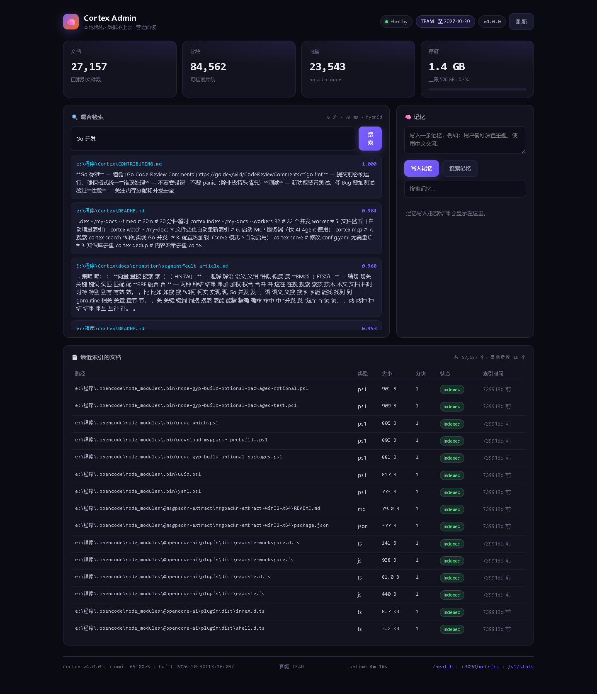

# Cortex 本地安装与运行实录

> 实测环境：Windows 11 / x86_64 / 本地 SSD / Go 1.25 构建 / `CGO_ENABLED=0`
> 版本：**v4.0.0**（commit `65100e5`）
> 日期：2026-10-30

## 1. 安装（两种方式）

### 方式 A：源码构建（本文采用）

```bash
git clone https://github.com/lh123aa/cortex
cd cortex
CGO_ENABLED=0 go build -ldflags "-s -w \
  -X github.com/lh123aa/cortex/internal/version.Version=v4.0.0" \
  -trimpath -o ~/bin/cortex ./cmd/cortex
```

产物：

| 版本 | 路径 | 体积 |
|---|---|---|
| 开源版 | `%USERPROFILE%\bin\cortex.exe` | **37.4 MB** |
| 企业版 | `%USERPROFILE%\bin\cortex-ee.exe` | **37.4 MB** |

```bash
$ cortex --version
cortex version v4.0.0 (commit 65100e5, built 2026-10-30T13:16:03Z)
```

两个二进制体积几乎一致 —— 企业版只多了审计扩展，没有引入新的运行时依赖。

### 方式 B：官方安装脚本（发布后）

```bash
curl -fsSL https://raw.githubusercontent.com/lh123aa/cortex/main/scripts/install.sh | sh
# Windows
irm https://raw.githubusercontent.com/lh123aa/cortex/main/scripts/install.ps1 | iex
```

## 2. 首次运行（零配置）

```bash
$ cortex start
  🧠  Cortex is starting...
  ──────────────────────────────────────────────────
  REST API   →  http://localhost:2021
  Health     →  http://localhost:2021/health
  Search     →  http://localhost:2021/v1/search?q=your+query

  💡  FTS-only mode. Install Ollama + nomic-embed-text for semantic search.

  Registered AI tools:
    ✅ Claude Code
    ✅ Cursor
    ✅ OpenCode

  📚  No documents indexed yet. Run: cortex index <path>
```

`cortex start` 会同时拉起 MCP（stdio）与 REST API，并把配置写入已安装的 AI 工具（写入前自动备份，原配置中的其它 MCP server 会保留）。

## 3. 索引真实语料

### 3.1 本项目源码 + 文档

```bash
$ time cortex -c configA.yaml index ./corpusA
  ✅ Indexing complete! 207 indexed, 2 skipped, 2 failed · 3.383s
```

- 语料：194 个 `.go`/`.md` 文件，1.2 MB
- 结果：**207 文档 / 3.38 s / 5.5 MB SQLite**
- 失败 2 个：`.sql` 与未知扩展名（当前版本不支持，见 §5）

### 3.2 一个 851 文件的真实文档库

用 XERJ 仓库的 `docs/`（10.1 MB，851 个 Markdown）作为外部语料：

```bash
$ time cortex -c configB.yaml index /path/to/xerj/docs
  ✅ Indexing complete! 277 indexed, 20 skipped, 20 failed · 6.841s
```

- 结果：**277 文档 / 3,060 分块 / 6.84 s / 16.4 MB SQLite**
- 20 failed：`.sql`、`.rs`、部分 YAML 等不在支持列表（**这是当前的真实能力缺口**）

### 3.3 27,157 文档的真实个人知识库

直接用现有 1.2 GB 知识库副本：

```bash
$ cortex -c configC.yaml status
📊 Cortex Status
Database:  .../C.db
Documents: 27157
Chunks:    84562
Vectors:   23543
Embedding: none

# 冷启动耗时
status 耗时 0.36 s
```

## 4. 检索体验

```bash
$ curl 'http://127.0.0.1:2021/v1/search?q=Go%20%E5%B9%B6%E5%8F%91&limit=3'
```

返回带 `path` / `section` / `snippet` 的结构化结果，snippet 以命中词为中心截取（不是从正文开头硬切）。

浏览器打开 `http://127.0.0.1:2021/admin` 可看到控制台：文档数、分块数、存储占用、套餐、混合检索框、记忆管理、最近索引文档列表。



## 5. 实测中发现的真实问题（如实记录）

| 问题 | 现象 | 影响 |
|---|---|---|
| 格式缺口 | `.rs` / `.sql` / 部分 `.yaml` 不被支持，直接 failed | 代码库、SQL 文档无法入库；XERJ 支持这些格式 |
| 英文语料尾部延迟 | 英文查询 p95 约 34 ms，中文约 1.4 ms | 英文文档库体验弱于中文 |
| 首查冷启动 | 冷查询 p95 约 10–22 ms；重复查询命中缓存后约 1 ms | 对交互无感，但压测时要注意缓存影响 |

> 宣发口径建议：**不要宣称"支持所有格式"**，明确写「Markdown / PDF / DOCX / 代码（Go/Python/JS/TS 等）/ 文本」。

## 6. 企业版功能验证

```bash
# 无 License
$ cortex-ee serve -p 2081
$ curl -s -o /dev/null -w '%{http_code}' localhost:2081/ee/audit
404

# 激活 Team License
$ cortex-ee license activate <team-key>
$ cortex-ee serve -p 2082
$ curl -s -o /dev/null -w '%{http_code}' localhost:2082/ee/audit
200
$ curl -s 'localhost:2082/ee/audit?limit=3'
{"count":3,"events":[{"time":"...","action":"POST /v1/memory","result":"201","remote_ip":"127.0.0.1"}]}
```


## 7. 复现命令

```bash
# 1) 构建
CGO_ENABLED=0 go build -o bin/cortex ./cmd/cortex
(cd ../Cortex-ee && CGO_ENABLED=0 go build -o bin/cortex-ee ./cmd/cortex-ee)

# 2) 索引
./bin/cortex index <your-corpus>

# 3) 服务
./bin/cortex serve -p 2021

# 4) 延迟测量（持久连接，避免客户端开销污染）
python _temp/launch/measure_keepalive.py \
  --base http://127.0.0.1:2021 --queries queries.json \
  --rounds 10 --top-k 10 --out result.json
```

> 测量方法说明：早期用 PowerShell `Invoke-WebRequest` 得到「stats 都要 38ms」的荒谬数字，
> 换成持久连接后同一端点降到 0.3–2.6 ms。**所有对外数字都必须用持久连接测。**
